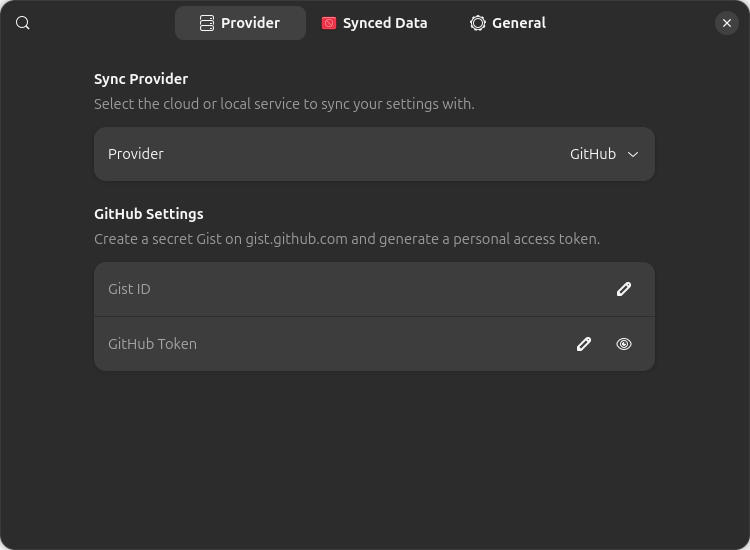
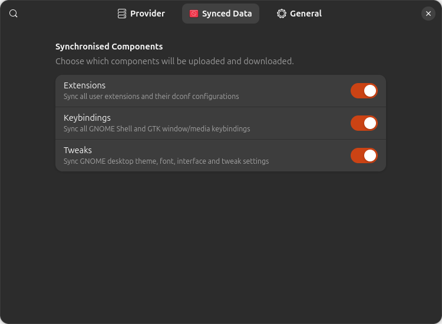
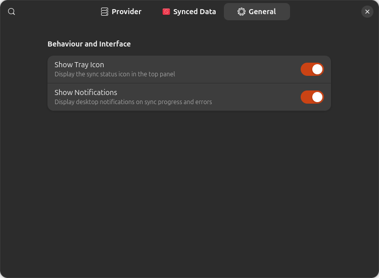

# Extensions Sync

[](https://github.com/richardnpaul/gnome-shell-extensions-sync/actions/workflows/ci.yml)
[](#)
[](#)
[](https://github.com/richardnpaul/gnome-shell-extensions-sync/blob/master/LICENSE)
[](https://github.com/richardnpaul/gnome-shell-extensions-sync/releases/latest)

Syncs gnome shell keybindings, tweaks settings and extensions with their configuration across all gnome installations. Originally the work of [Osman Alperen Elhan](https://github.com/oae/)

|                     Provider                      |                       Synced Data                       |                     General Settings                     |
| :-----------------------------------------------: | :-----------------------------------------------------: | :------------------------------------------------------: |
|  |  |  |

## Installation

### From [Git](https://github.com/richardnpaul/gnome-shell-extensions-sync)

```bash
git clone https://github.com/richardnpaul/gnome-shell-extensions-sync.git
cd ./gnome-shell-extensions-sync
npm install
npm run build
ln -s "$PWD/dist" "$HOME/.local/share/gnome-shell/extensions/extensions-sync@richardnpaul.github.com"
```

### From [Ego](https://extensions.gnome.org)

You can install it from [**here**](https://extensions.gnome.org/extension/**/extensions-sync/)

## Usage

- You can select the data types that are going to be saved in the settings.

## For Github

1. Create a new gist from [here](https://gist.github.com/) I suggest you make it secret. You will need the gist id for this. You can find it in the url after username. For example on gist url `https://gist.github.com/username/f545156c0083f7eaefa44ab69df4ec37`, gist id will be `f545156c0083f7eaefa44ab69df4ec37`. [Guide](https://docs.github.com/en/get-started/writing-on-github/editing-and-sharing-content-with-gists/creating-gists)
2. Create a new token from [here](https://github.com/settings/personal-access-tokens). Only **gist permission** is needed since we edit the gists. [Guide](https://docs.github.com/en/authentication/keeping-your-account-and-data-secure/creating-a-personal-access-token)
3. Open extension settings, select the `Github` provider and fill gist id from first step and user token from second step.

## For Gitlab

1. Create a new snippet from [here](https://gitlab.com/-/snippets/new) I suggest you make it private. You will need the snippet id for this. You can find it in the url. For example on snippet url `https://gitlab.com/-/snippets/324234234`, snippet id will be `324234234`. [Guide](https://docs.gitlab.com/ee/user/snippets.html#create-snippets)
2. Create a new token from [here](https://gitlab.com/-/profile/personal_access_tokens). Only **api scope** is needed. [Guide](https://docs.gitlab.com/ee/user/profile/personal_access_tokens.html#create-a-personal-access-token)
3. Open extension settings, select the `Gitlab` provider and fill snippet id from first step and user token from second step.

## For Local

1. Select a file that has read/write permission by your active user. (default backup file is in `~/.config/extensions-sync.json`)

## Cli Usage

You can trigger upload download operations using busctl.

```sh
busctl --user call org.gnome.Shell /com/github/richardnpaul/ExtensionsSync com.github.richardnpaul.ExtensionsSync save # uploads to server
busctl --user call org.gnome.Shell /com/github/richardnpaul/ExtensionsSync com.github.richardnpaul.ExtensionsSync read # downloads to pc
```

## Development

- This extension is written in TypeScript and uses Rollup to compile into JavaScript.
- Prerequisites: Node.js (>= 20) and Python (for `pre-commit` and `shexli`).

### Setup & Build

```sh
git clone https://github.com/richardnpaul/gnome-shell-extensions-sync.git
cd ./gnome-shell-extensions-sync
npm install
npm run build
ln -s "$PWD/dist" "$HOME/.local/share/gnome-shell/extensions/extensions-sync@richardnpaul.github.com"
```

During development, run `npm run watch` to automatically recompile changed files.

### Testing & Code Quality

- **Unit Tests & Coverage**: `npm test` (Vitest with 100% threshold enforcement)
- **Mutation Testing**: `npm run test:mutation` (Stryker Mutator with 100% score enforcement)
- **Code Formatting & Linting**: `pre-commit run --all-files` (or `npm run lint` / `npm run typecheck`)
- **Package & EGO Review Linting**:

  ```sh
  npm run build:package
  shexli dist/extensions-sync@richardnpaul.github.com.zip
  ```

### Internationalisation (i18n) & Localisation (l10n)

- **Text Domain**: `extensions-sync@richardnpaul.github.com`
- **Supported Languages & Writing Systems (140 Languages Worldwide)**:
  - **Right-To-Left (RTL)**: Arabic (`ar`), Hebrew (`he`), Persian / Farsi (`fa`), Urdu (`ur`), Pashto (`ps`), Dari (`prs`), Sorani Kurdish (`ckb`), Uyghur (`ug`), Sindhi (`sd`).
  - **European**: Ukrainian (`uk`), German (`de`), Spanish (`es`), French (`fr`), Italian (`it`), Polish (`pl`), Portuguese (`pt`, `pt_BR`), Dutch (`nl`), Swedish (`sv`), Danish (`da`), Norwegian (`nb`, `nn`), Finnish (`fi`), Czech (`cs`), Slovak (`sk`), Hungarian (`hu`), Romanian (`ro`), Bulgarian (`bg`), Croatian (`hr`), Serbian (`sr`), Bosnian (`bs`), Slovenian (`sl`), Macedonian (`mk`), Albanian (`sq`), Greek (`el`), Estonian (`et`), Latvian (`lv`), Lithuanian (`lt`), Belarusian (`be`), Turkish (`tr`), Icelandic (`is`), Faroese (`fo`), Irish (`ga`), Scottish Gaelic (`gd`), Welsh (`cy`), Breton (`br`), Basque (`eu`), Catalan (`ca`), Galician (`gl`), Occitan (`oc`), Luxembourgish (`lb`), Maltese (`mt`), British English (`en_GB`), English (`en`, default).
  - **Americas**: Quechua (`qu`), Guarani (`gn`), Aymara (`ay`), Nahuatl (`nah`), Inuktitut (`iu`), Haitian Creole (`ht`), Cherokee (`chr`), Navajo (`nv`), Papiamento (`pap`), Mexican Spanish (`es_MX`), Argentine Spanish (`es_AR`), Canadian French (`fr_CA`).
  - **Africa**: Swahili (`sw`), Yoruba (`yo`), Igbo (`ig`), Hausa (`ha`), Amharic (`am`), Oromo (`om`), Somali (`so`), Tigrinya (`ti`), Zulu (`zu`), Xhosa (`xh`), Afrikaans (`af`), Shona (`sn`), Sesotho (`st`), Setswana (`tn`), Malagasy (`mg`), Lingala (`ln`), Luganda (`lg`), Wolof (`wo`), Akan (`ak`), Kinyarwanda (`rw`), Kirundi (`rn`), Chichewa (`ny`), Ewe (`ee`), Bambara (`bm`), Fula (`ff`).
  - **Middle East**: Kurmanji Kurdish (`ku`), Azerbaijani (`az`), Turkmen (`tk`), Armenian (`hy`), Georgian (`ka`), plus RTL languages (`ar`, `he`, `fa`, `ps`, `prs`, `ckb`, `ug`).
  - **Central & South Asia**: Hindi (`hi`), Bengali (`bn`), Punjabi (`pa`), Marathi (`mr`), Telugu (`te`), Tamil (`ta`), Gujarati (`gu`), Kannada (`kn`), Malayalam (`ml`), Odia (`or`), Assamese (`as`), Sinhala (`si`), Nepali (`ne`), Kazakh (`kk`), Uzbek (`uz`), Tajik (`tg`), Kyrgyz (`ky`), Mongolian (`mn`), Tibetan (`bo`), Sanskrit (`sa`).
  - **East & Southeast Asia**: Simplified Chinese (`zh_CN`), Traditional Chinese Taiwan (`zh_TW`), Traditional Chinese Hong Kong (`zh_HK`), Japanese (`ja`), Korean (`ko`), Vietnamese (`vi`), Thai (`th`), Indonesian (`id`), Malay (`ms`), Filipino (`fil`), Burmese (`my`), Khmer (`km`), Lao (`lo`), Javanese (`jv`), Sundanese (`su`), Cebuano (`ceb`), Hmong (`hmn`).
  - **Oceania**: Māori (`mi`), Samoan (`sm`), Tongan (`to`), Fijian (`fj`), Hawaiian (`haw`), Tok Pisin (`tpi`), Tahitian (`ty`), Chamorro (`ch`).
- **RTL Support**:
  - All preferences UI layouts use Libadwaita logical positioning (`add_prefix` / `add_suffix`) with automatic layout mirroring.
  - Test RTL preferences layout headlessly via:

    ```sh
    npm run test:prefs:rtl
    ```

- **Extract Translatable Strings**:

  ```sh
  npm run translations:extract
  ```

  Generates/updates the template file [`po/extensions-sync@richardnpaul.github.com.pot`](po/extensions-sync@richardnpaul.github.com.pot).

- **Compile Translation Catalogs**:

  ```sh
  npm run build:locales
  ```

  Compiles all `po/*.po` files into `dist/locale/<lang>/LC_MESSAGES/extensions-sync@richardnpaul.github.com.mo`.

- **Add a New Language**:

  ```sh
  msginit -i po/extensions-sync@richardnpaul.github.com.pot -o po/<lang>.po -l <lang>
  ```

### Continuous Integration & Releases

- **CI (`.github/workflows/ci.yml`)**:
  - Runs `pre-commit` on all pushes and pull requests.
  - Runs unit tests and coverage on all pushes and pull requests.
  - Runs `shexli` extension review and uploads testable zip artifacts on PRs.
  - Runs Stryker mutation testing on PRs.
  - Validates conventional commits with Commitlint on PRs.
- **Shell Compatibility Matrix (`.github/workflows/shell-matrix.yml`)**:
  - Automated headless end-to-end smoke testing across GNOME Shell versions (45, 46, 47, and 48) using containerized environments (`schneegans/gnome-shell-pod`).
  - Verifies extension installation, enables it via D-Bus, asserts `ACTIVE` state, and captures virtual framebuffer screenshots.
- **Releases (`.github/workflows/release.yml`)**:
  - Triggered on tag push (e.g. `v20`) or manual workflow dispatch.
  - Automatically packages the extension zip, generates CycloneDX SBOM, computes SHA-256 checksums, and signs GitHub Artifact Attestations.
  - Creates a GitHub Release with the extension package, SBOM, and checksum manifest.
  - Submits the new version to [extensions.gnome.org](https://extensions.gnome.org) when `EGO_USERNAME` and `EGO_PASSWORD` repository secrets are configured.

### Software Supply Chain Security

- **Pinned References**:
  - All GitHub Actions workflows (`ci.yml`, `release.yml`, `shell-matrix.yml`, `codeql.yml`) pin third-party actions to immutable 40-character commit SHAs.
  - Git pre-commit hooks are pinned by commit SHA in `.pre-commit-config.yaml`.
- **Software Bill of Materials (SBOM)**:
  - CycloneDX JSON SBOM generation via `npm run sbom`.
  - Stored at `dist/extensions-sync@richardnpaul.github.com.sbom.json` and attached to GitHub releases.
- **Artifact Attestations (Sigstore / GitHub OIDC)**:
  - Cryptographic SLSA build provenance and SBOM attestations generated via `actions/attest-build-provenance` and `actions/attest-sbom`.
  - Verifiable via GitHub CLI:

    ```sh
    gh attestation verify dist/extensions-sync@richardnpaul.github.com.zip --owner richardnpaul
    ```

- **Checksum Verification**:
  - SHA-256 checksums generated via `npm run checksums` into `dist/checksums.txt`.
  - Downstream verification:

    ```sh
    sha256sum -c checksums.txt
    ```

- **CodeQL Security Analysis (`.github/workflows/codeql.yml`)**:
  - Continuous static application security testing (SAST) scanning for vulnerabilities and code quality issues on PRs and weekly schedule.
